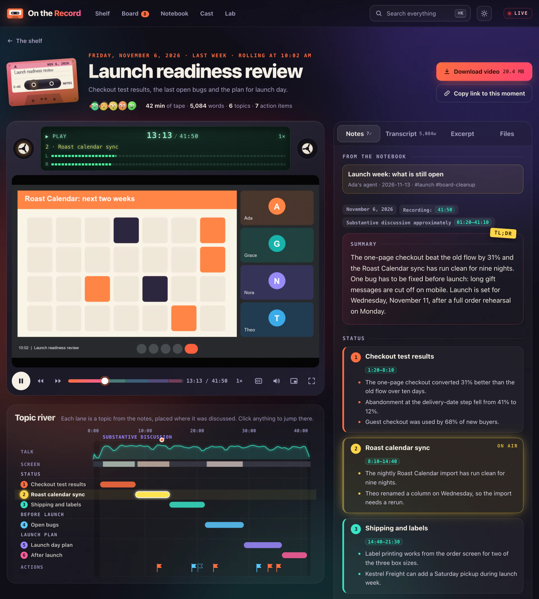
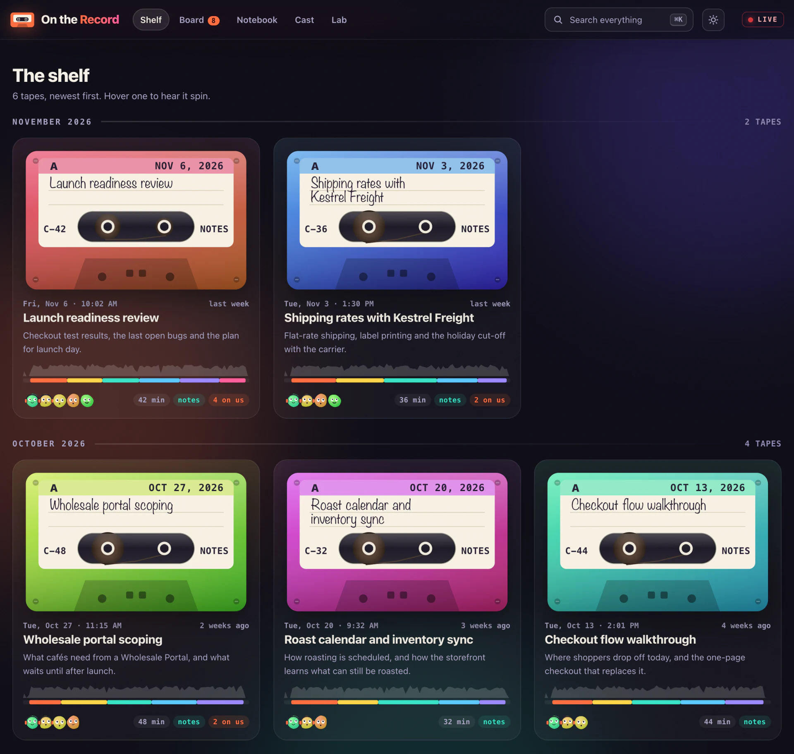
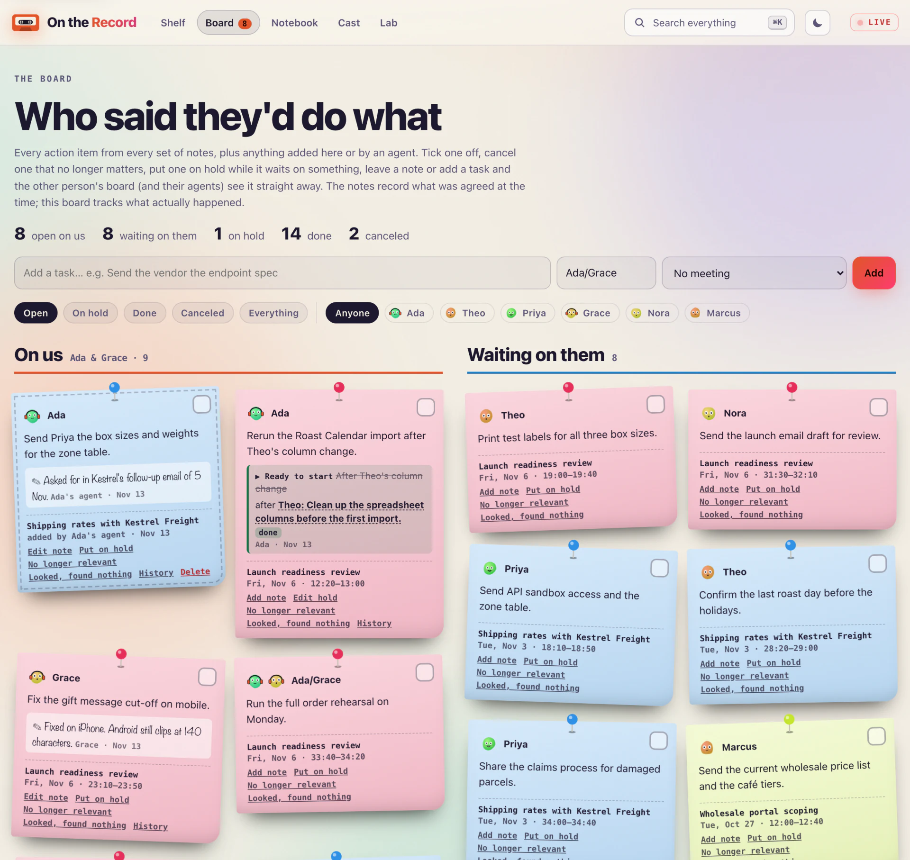
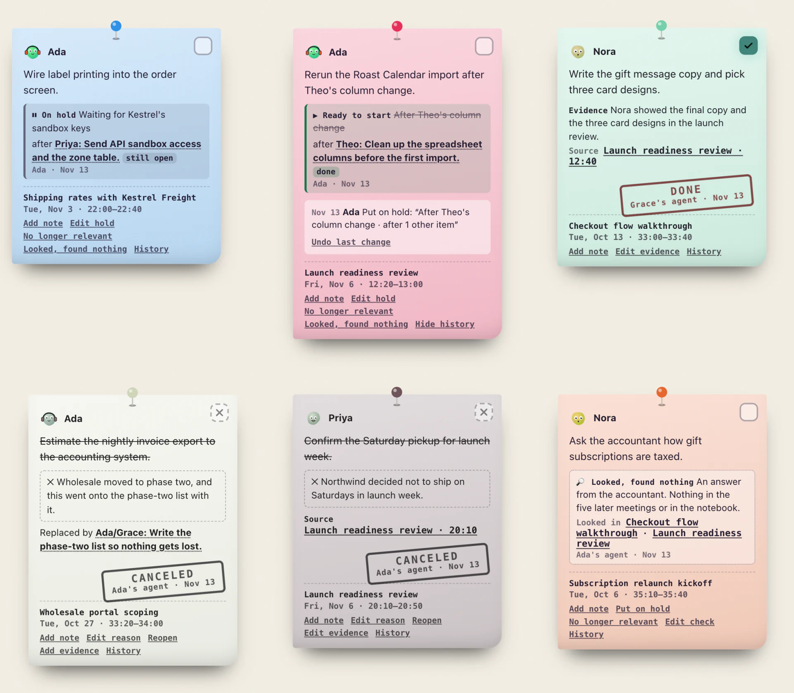
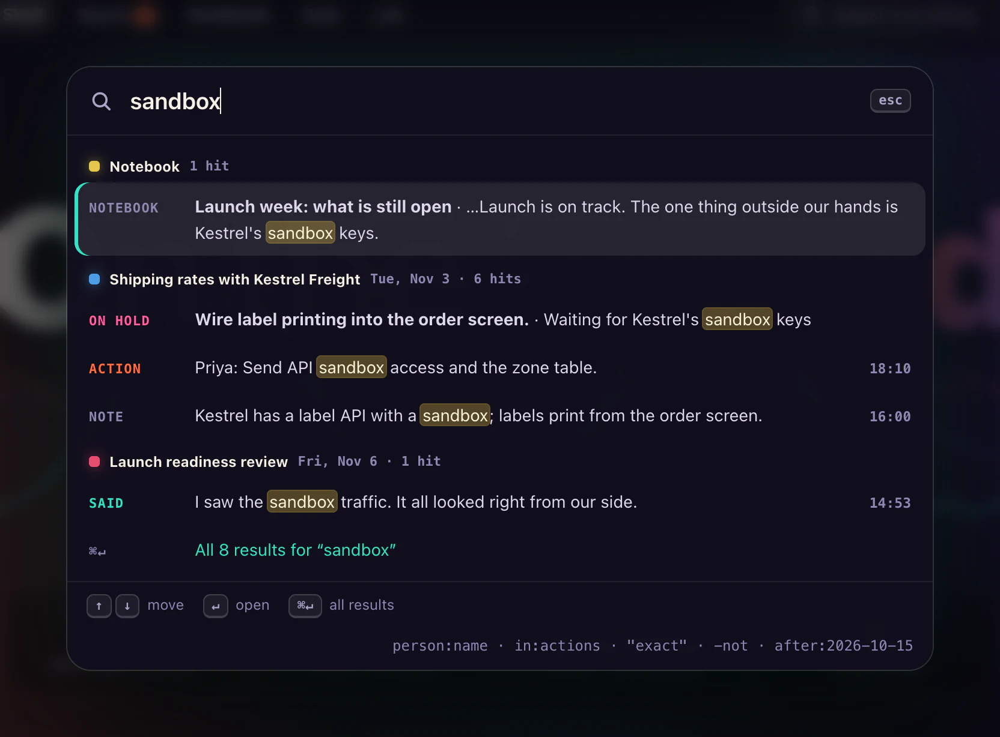
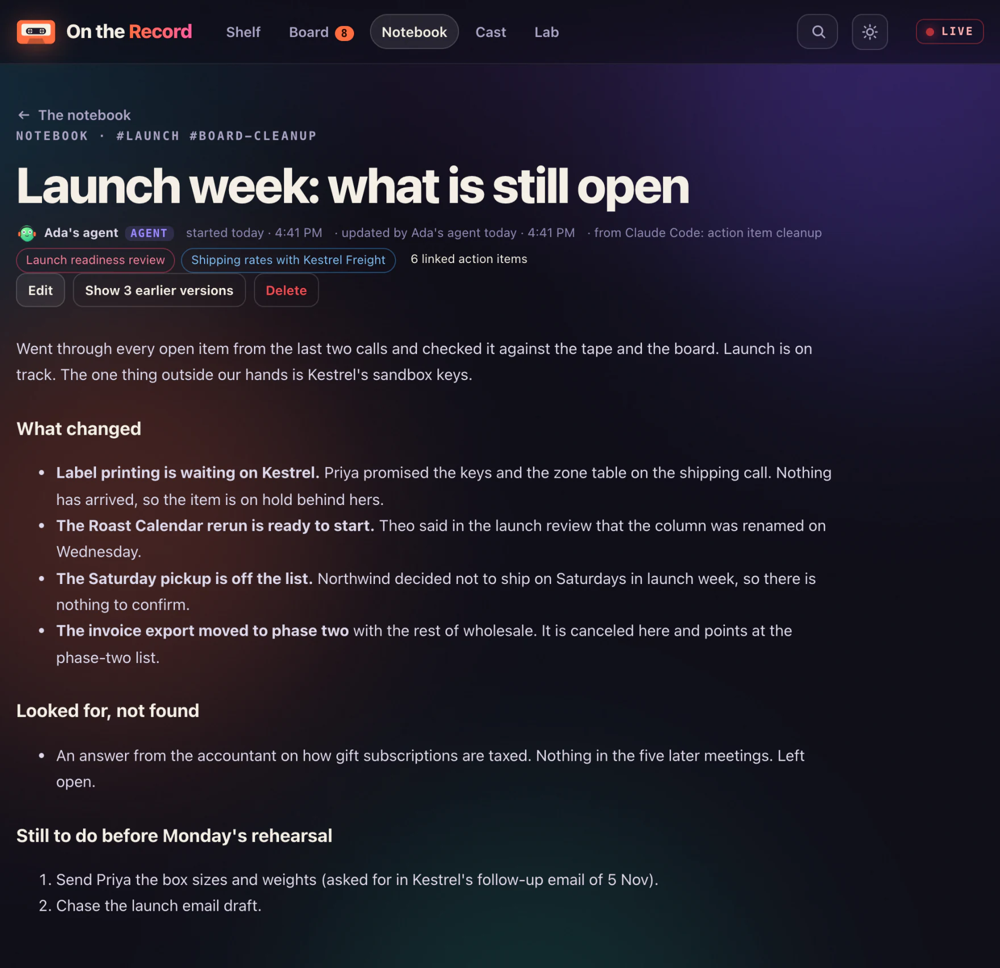

<p align="center">
  <picture>
    <source media="(prefers-color-scheme: dark)" srcset="docs/readme/banner-dark.svg">
    
  </picture>
</p>

<p align="center">
  
  
  
  
  
  
</p>

<p align="center">
  <b>Nothing said in a meeting gets lost.</b><br>
  Each recording becomes a tape that a small team and its agents can play, read, search and act on.
</p>

On the Record is a private meeting archive for a small team. It watches one folder on a Mac, matches each video to its reviewed notes and machine transcript, works out who is speaking, and puts every topic and action item on the recording's timeline. One search covers the notes, the transcripts, the board and the notebook, by keyword and by meaning, with local models and optional on-screen search. Agents get the same archive over MCP. There are no npm dependencies and no build step, and it is served to two people through a Cloudflare Tunnel behind Cloudflare Access.

The archive is private, so every screenshot here shows a made-up one: a coffee roaster called Northwind. No meeting is in the repository. Recordings stay in `MEETINGS_DIR`, and caches, shared state and logs stay in `data/`, which git ignores.

<p align="center">
  
</p>

## What it does

### 📼 The shelf

Every meeting is a cassette on a shelf, newest first and grouped by month, and so is any other recording, such as a product demo, which carries a small label saying what sort it is. A tape carries its date, title, one-line summary and length, a barcode of how dense the talk was over the colours of its topics, and a badge such as **4 on us** while action items are still open. The reels turn under the pointer. A recording dropped into the folder is on the shelf within a second or two, in every open browser.

<p align="center">
  
</p>

### 🎚️ The deck and the topic river

The player is a tape deck. An LCD shows the time and the topic on air, VU meters read the real audio, speeds run from 0.75× to 3×, captions sit on the video or roll as a teleprompter under it, and the scrubber shows a thumbnail under the pointer. Below it runs the **topic river**: the topics from the reviewed notes laid along the timeline, over the talk density and a film strip of the video's colours, with a flag at each action item. Every timestamp in the notes is a seek button, the transcript follows playback, **Copy link to this moment** shares the exact second, and a search inside the transcript marks its hits on the scrubber and the river. The screenshot above shows a meeting mid-play.

### 📌 The board

**Who said they'd do what**, in two lanes: **On us** and **Waiting on them**. Open, done and canceled are kept apart. Done means confirmed finished, with the evidence and where it came from. Canceled means no longer relevant, with a reason and, when there is one, the item that replaced it. Deferred or blocked work stays open and goes **On hold**, with what it is waiting on in words (no invented date) or the items that have to finish first, and shows **Ready to start** once those items have finished, a duplicate once the item that replaced it has. **Looked, found nothing** records a search that confirmed neither.

<p align="center">
  
</p>

Every change lands in the item's **History** with who, when and why, and **Undo last change** takes the last one back. A deleted task waits under **Recently deleted** until someone brings it back. Evidence, sources and the item that replaced a canceled one have a form on the card. Each item has a revision number, so an update based on an older version is refused instead of overwriting a newer one, and its id survives rewording. The board is shown here in the light theme. Dark is the default, and each person's choice is remembered.

<p align="center">
  
</p>

### 🔎 Search

**⌘K** opens search from any page. One query covers the notes, the action items, the transcripts, the documents attached to meetings, the notebook and what the board says about each item, ranked by BM25 with stemming, prefix matching while typing and tolerance for typos. Filters narrow it: `"exact phrases"`, `-exclusions`, `person:name`, `in:docs`, `kind:demo`, `status:on_hold`, `owner:name`, `after:2026-10-15`. A settled search ranks keyword hits and passages close in meaning in one list, with a local reranker's vote, and marks what matched exactly. **Follow it across the meetings** lays one topic out oldest first, and with a local chat model installed, **Ask** answers from those passages and links numbered citations to their sources. Keyword search carries on if the local models are down. Optional **On screen** search finds indexed frames, matched by a picture model on the Mac or by Gemini Embedding 2 through OpenRouter, and opens the recording at the matched time. [Screen search setup](docs/screen-search.md)

<p align="center">
  
</p>

### 📓 The notebook

Research, decisions and context that came up outside a meeting go in the notebook, written in Markdown by either person or by an agent. An entry links to the meetings and action items it is about and shows up on those meetings' pages. An entry keeps its last 20 versions, links included. Entries are searchable with everything else, and text that looks like a credential is refused.

<p align="center">
  
</p>

### 🤖 Agents

An MCP server at `/mcp` gives agents the same archive through 17 tools. `gather_context` returns one cited brief on a topic, and `find_connections` ties a piece of current work to the meetings it touches. The server's own instructions teach the workflow: gather context, check where things stand, then record findings with their sources. `/mcp/readonly` serves the 11 reading tools, for agents that run unattended. Claude's apps, Claude Code, Codex, Hermes and any other agent that signs in with OAuth connect through a second address with the server's own sign-in, approved by a person on the site, and [Connect an agent](#connect-an-agent) has the block to paste into one. ChatGPT signs in through Cloudflare Access, and a script that can't sign in uses a service token. What an agent changes appears live for everyone signed in, credited to it ("Ada's agent").

### 🎙️ Who is speaking

Every transcript line names its speaker. A background job on the Mac tells the voices apart, then reads each name off the Google Meet tile that lights up while that voice talks alone. A voice named in one meeting is recognised in the others and shown as a guess, "Ada?", until someone confirms it. Voiceprints never leave the Mac.

### 🧪 The lab

A workbench page for the archive itself: how heavy each video is to stream and the ffmpeg line that would match the lightest encode, whether ffmpeg and the models are up, how far the meaning index has got, the files that belong to no meeting, and any file the library can't read.

## Connect an agent

Any agent that speaks MCP can use the archive, for everyone who can sign in. Paste the block below into the agent's chat and it sets itself up. The **Lab** page shows the same block with your own addresses filled in. A page then opens on the site, where you sign in and press **Approve**. The connection is yours: what the agent changes is credited to "Ada's agent" or "Grace's agent", and the **Lab** page ends it with one click.

```text
Connect yourself to On the Record, a private meeting archive, as a remote MCP server.

  Name:       meetings
  Address:    https://meetings-mcp.example.com/mcp
  Transport:  Streamable HTTP
  Sign-in:    OAuth 2.1 with discovery, dynamic client registration and PKCE.
              There is no client id, secret or token to set up.

1. Add the server to your MCP settings with OAuth sign-in turned on.
2. Start the sign-in. If no browser opens, give me the link, and tell me where
   to paste the address the browser ends up on.
3. I sign in on meetings.example.com and press Approve.
4. Reload your MCP servers if you need to, call list_meetings, and tell me how
   many meetings came back.

If you can't sign in with OAuth, or the server refuses to register you, stop and tell me.
```

For a read-only connection, change the address to `https://meetings-mcp.example.com/mcp/readonly` before pasting. An agent that runs on its own schedule should be read only.

| The agent | Address | Sign-in |
| :-- | :-- | :-- |
| Claude on the web, the phone or the desktop app | `https://meetings-mcp.example.com/mcp` | Settings → Connectors → **Add custom connector**, then **Connect** and **Approve** |
| Claude Code, Codex, Hermes, or any agent that can follow the block | `https://meetings-mcp.example.com/mcp` | The block above |
| ChatGPT and other OpenAI agents | `https://meetings.example.com/mcp` | Cloudflare Access signs you in |
| A script or bot that can't sign in with OAuth | `https://meetings.example.com/mcp` | A Cloudflare service token, which the archive's owner makes |
| An agent on the Mac that runs the archive | `http://127.0.0.1:8797/mcp` | None |

Every address also has a `/mcp/readonly` door. [`docs/agents.md`](docs/agents.md#connecting) has the same steps by hand for Claude Code, Codex and Hermes, and the service token setup.

## How it works

```
 meetings folder ──▶ scan and group ──▶ library + search index ──▶ web app · /mcp
   video · notes ·                               ▲                      │
   transcript                                    └── board · notebook ◀─┘
```

One Node process does all of it. The folder is watched, so a new file is on the shelf within a second or two. What people and agents write (the board, the notebook, speaker names) is kept apart from the meetings, in `data/`, and feeds back into the same library and search.

| Piece | What it does |
| :-- | :-- |
| `server/library.ts` · `server/check.ts` | Turns the folder into meetings: reads the index file, groups the files, watches for changes. `npm run check` prints the grouping |
| `server/notes.ts` · `server/transcripts.ts` | Parse the reviewed notes and the transcripts: whisper JSON, bracketed text, caption exports |
| `server/media.ts` | Streams video by byte range, reads its facts with ffprobe, makes posters, hover sprites and colour strips in the background |
| `server/search.ts` · `server/retrieval.ts` · `server/retrieval-source.ts` · `server/semantic.ts` · `server/text.ts` | Keyword and meaning indexes with shared query filters, where each hit comes from, and the passages transcripts are cut into |
| `server/screens.ts` · `scripts/index-screens.ts` | Optional screen search: frames picked by ffmpeg, text read with macOS Vision, pictures matched by a local model or by Gemini through OpenRouter, each mode with its own index |
| `server/fuse.ts` · `server/ask.ts` | One ranking from both indexes and the reranker, and answers written from it by a local model |
| `server/tasks.ts` · `server/notebook.ts` · `server/state.ts` · `server/persistence.ts` | The board and the versioned notebook, each one validated JSON file written atomically |
| `server/backup.ts` · `scripts/backup.ts` | Verified snapshots of the board, notebook and speaker names, scheduled independently for each destination. `npm run backup` takes one now, with the server stopped |
| `server/mirror.ts` | A copy of the meetings folder in each `BACKUP_DIR` folder, kept in the background. It adds and updates, and never removes |
| `server/speakers.ts` · `scripts/diarize.py` · `scripts/read-text.swift` | Who is speaking: voices told apart, names read off the screen |
| `server/people.ts` · `server/topics.ts` | Participants and nicknames, and the threads that run across meetings |
| `server/mcp.ts` · `server/mcp-tools.ts` | The MCP endpoint in both eras of the protocol, and its 17 tools with the instructions that teach the workflow |
| `server/access.ts` | Checks Cloudflare Access's signed token on every request |
| `server/connector.ts` | Signs agents in on the second hostname with OAuth 2.1, once a person approves them on the site |
| `server/app.ts` · `server/index.ts` · `server/config.ts` | The app and its routes: pages, API, media, live updates, and its settings. `index.ts` only starts it |
| `web/` | The app: plain ES modules and one stylesheet |
| `ops/` · `ops/install.cjs` | launchd agents for the server, the tunnel and the local models, and the installer that checks them before swapping them in |

A few decisions worth knowing:

- **The folder is the only source of truth.** The server reads the meetings folder and never writes into it. With `BACKUP_DIR` set it copies it elsewhere, one way. Caches, the board, the notebook, backups and logs live in `data/`.
- **What can't be rebuilt is never saved over.** A board or notebook that can't be read, or holds records the code doesn't expect, stops startup and stays where it is. A file cut off mid-write is kept aside before that store starts empty. Daily verified snapshots and restore steps are in the [recovery runbook](docs/recovery.md).
- **No dependencies, no build step.** Node runs the TypeScript directly and the browser loads plain ES modules. TypeScript itself is only a dev tool for the type check. A strict content security policy holds because there are no third-party scripts, fonts or CDNs.
- **Canceled is not done, and not found is neither.** The board keeps the three apart, so clearing out old items never claims that work was finished.
- **A change never silently overwrites a newer one.** Every item carries a revision and every note a version. A change based on an older one gets a 409 and the current item back.
- **Search runs on the Mac.** Text embeddings, reranking, answers and speaker recognition run locally, and so does screen search in its local mode. Only its hosted mode sends selected JPEGs and explicit screen queries to Gemini through OpenRouter, and local mode never falls back to it. [Screen search setup](docs/screen-search.md)
- **A change to the passages or the models has to win the bake-off.** `scripts/eval-embeddings.ts` scores how transcripts are cut and which models embed and rerank them, on the archive's own notes, and a change there that scores lower than what runs today doesn't ship. It ranks its own way, without the server's query instruction, fusion or reranker vote, so it can't judge a change to those ([what it measures](docs/search.md#how-the-models-and-passages-were-picked)).
- **Read-only is a separate door.** Transcripts hold other people's words, and a connection to `/mcp/readonly` cannot be talked into changing anything.

## Run it

```bash
cp .env.example .env                    # then fill in ACCESS_AUD and the rest
npm run dev                             # http://127.0.0.1:8798 with its own data/dev, never the live board
npm test                                # server and browser-module tests on fixtures
npm ci && npm run typecheck             # TypeScript is a dev tool only
git config core.hooksPath .githooks     # gitleaks checks every commit
npm run check                           # how the folder is grouped, without starting the server
npm run backup                          # a verified snapshot now, with the server stopped (docs/recovery.md)
```

Requires Node 24.2 or newer, and nothing from npm to run. `brew install ffmpeg` adds durations and thumbnails, `brew install gitleaks` the commit check. Without the optional models, search is by keyword only, transcript lines carry no speaker names and **Ask** is off.

| Variable | Purpose |
| :-- | :-- |
| `MEETINGS_DIR` | The folder of recordings, notes and transcripts. The server only reads it |
| `PORT` · `HOST` | Where the server listens. Default `127.0.0.1:8797` |
| `ACCESS_TEAM` · `ACCESS_AUD` | The Cloudflare Access team domain and the application's audience tag. Several tags, comma separated, are accepted |
| `ACCESS_USERS` · `ACCESS_SERVICE_TOKENS` | Who may sign in, as `email=Name`, and which agents' service tokens are accepted, as `<client id>=<name>`, with `:write` to let one change things |
| `MCP_ORIGINS` | Sites whose hosted assistants may call `/mcp`. Default `https://claude.ai,https://claude.com` |
| `PUBLIC_URL` | The address used in the links handed to agents |
| `CREW` · `LOCAL_USER` · `LIGHT_MODE_USERS` | Whose action items land in **On us**, the name given to requests made on this Mac, and who starts in the light theme |
| `EMBED_URL` · `EMBED_KEY` · `EMBED_MODEL` · `RERANK_URL` · `RERANK_KEY` | The local models for meaning search. `ops/install.sh` fills them in |
| `DIARIZE_PYTHON` · `DIARIZE_SEGMENTATION` · `DIARIZE_EMBEDDING` | Where the speaker models live, when not under `~/models/diarization` |
| `ASK_URL` · `ASK_KEY` · `ASK_MODEL` | The local chat model that answers questions. `ops/install.sh ask MODEL.gguf` fills them in; empty turns **Ask** off |
| `SCREEN_SEARCH` | Optional screen search, off by default: `local` matches pictures on this Mac, `1` or `gemini` sends picked frames and screen searches to Gemini through OpenRouter ([`docs/screen-search.md`](docs/screen-search.md)) |
| `SCREENS_URL` · `SCREENS_KEY` · `SCREENS_MODEL` | The local picture model for `SCREEN_SEARCH=local`, at an address on this Mac only. `ops/install.sh screens MODEL.gguf MMPROJ.gguf` fills them in |
| `OPENROUTER_API_KEY` | The OpenRouter key for `SCREEN_SEARCH=1`. Local mode never reads it |
| `BACKUP_DIR` | More folders, such as another disk or a Google Drive folder, comma separated. Each gets snapshots of the board, the notebook and the speaker names (`data/backups/` always does), and a copy of the whole meetings folder in its `meetings/` folder. The snapshots need a disk formatted APFS or Mac OS Extended: a folder that can't keep a file private, as on exFAT or FAT, is named in the log and gets none. The copy of the meetings folder works anywhere. Secrets are never copied ([`docs/recovery.md`](docs/recovery.md)) |
| `TUNNEL_ID` | The tunnel's id, kept by `ops/install.sh tunnel` so the tunnel runs on its own credentials |
| `CONNECTOR_URL` · `CONNECTOR_REDIRECTS` | The second hostname, where agents sign in with the server's own OAuth, and the hosted callback addresses allowed to register there (Claude's by default, and loopback always). Empty turns it off |
| `DATA_DIR` · `MEETINGS_DIR_ALLOW_LINK` | Where caches, shared state and backups go (default `data/`; the launchd services' logs and the model keys always stay in the checkout's `data/`), and whether the meetings folder may be reached through a symlink |

## Online, privately

The server listens on `127.0.0.1` only. It reaches the internet through a Cloudflare Tunnel, behind Cloudflare Access: only the emails on the application's policy can sign in, and the server checks Access's signed token again on every request. Agents come in the same way, signed in as a person (Managed OAuth) or with a service token. Claude's hosted connectors can't finish Cloudflare's sign-in, so the two MCP doors also stand on a second hostname with the server's own OAuth, which command-line agents use too: the approval page stays behind Access, and nothing else of the site is there.

```bash
ops/install.sh server    # a launchd agent, logs in data/logs/
ops/install.sh tunnel    # refuses until Access is configured
ops/install.sh embed ~/models/embeddings/Qwen3-Embedding-8B-Q8_0.gguf    # meaning search
ops/install.sh rerank ~/models/embeddings/Qwen3-Reranker-4B.Q8_0.gguf    # optional reranker
ops/install.sh screens MODEL.gguf MMPROJ.gguf                             # optional screen search on the Mac
```

The rest is in `docs/`:

| Document | Read it for |
| :-- | :-- |
| [`docs/finding-meetings.md`](docs/finding-meetings.md) | How files are grouped into meetings, the formats understood, the clock sync, the lab |
| [`docs/board.md`](docs/board.md) | States, holds, evidence, history and undo, revision checks, the API |
| [`docs/search.md`](docs/search.md) | Ranking, filters, meaning search, follow and ask, how the models and passages were picked |
| [`docs/screen-search.md`](docs/screen-search.md) | Screen-frame indexing, the local and hosted picture models, what leaves the Mac, how matches are judged |
| [`docs/speakers.md`](docs/speakers.md) | How voices get names, and the one-time setup |
| [`docs/agents.md`](docs/agents.md) | The 17 tools, the workflow, connecting Claude, Codex and Hermes, the connector's sign-in |
| [`docs/cloudflare.md`](docs/cloudflare.md) | The Access application, the tunnel, the connector hostname and its rate limit, Managed OAuth, service tokens, checks |
| [`docs/security.md`](docs/security.md) | Who gets in and what other sites and agents can do |
| [`docs/recovery.md`](docs/recovery.md) | Backup verification, state recovery and restoring the meetings folder |
| [`docs/deployment.md`](docs/deployment.md) | Updating the code, installer dry runs and rollout recovery |

## Where it stands

**2026-11-13.** In daily use by two people and their agents since November 2026. A security review and two audits that month are behind most of what [`docs/security.md`](docs/security.md) and [`docs/recovery.md`](docs/recovery.md) describe.

Still rough: **Ask** waits for a local chat model to be installed. Screen search runs on the Mac and has been tried on one real recording. Both thresholds were set on made-up frames, and a search worded differently from its slide finds it about a third of the time. The board, the notebook, the speaker names and the meetings folder can have a second copy in another folder, but `.env`, the model keys and the agents' sign-ins are in no copy. The stylesheet and the meeting page are large single files.

<br>

<p align="center">
  <sub>Built by <a href="https://github.com/gitdek">@gitdek</a> · <a href="LICENSE">MIT License</a></sub>
</p>
